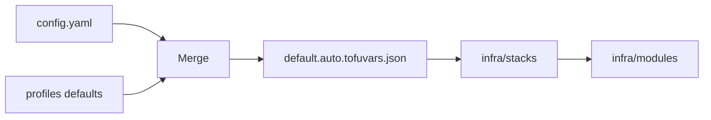

# Architecture

The installer binary orchestrates OpenTofu against an embedded (or filesystem) **stack** composed from **modules**. Customer-specific values never ship inside the product repository.

## Content resolution

1. `internal/packaged` embed (release builds via `make package-content`)
2. `INSTALLER_CONTENT_ROOT` environment variable
3. Walk up from cwd or executable to find `profiles/` and `infra/`

## State

- No `backend` in customer config → state file `tofu.tfstate` in the customer working directory.
- `backend.type: azurerm` → generated `backend.tofu` during apply/plan.