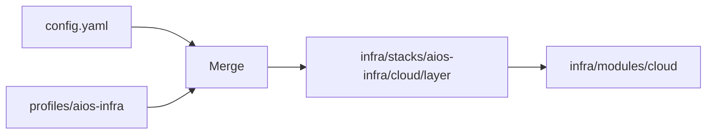

# Architecture

The **rtifact** binary orchestrates OpenTofu against an embedded (or filesystem) **stack** composed from **modules**. Customer-specific values never ship inside the product repository.

## Content resolution

1. `internal/packaged` embed (release builds via `make package-content`, filtered by `PACKAGED_CLOUDS`)
2. `INSTALLER_CONTENT_ROOT` environment variable
3. Walk up from cwd or executable to find `profiles/` and `infra/`

## State

- `state.backend: local` → `backend "local"` under `~/.rtifact/<prefix>/state/<layer>.tfstate`
- `state.backend: azurerm|s3|gcs` → cloud `Provider.Backend()`; `rtifact bootstrap` applies the `state-backend` layer first
- Cross-layer inputs: `terraform_remote_state` via `upstream_state` (see [layer-contracts.md](layer-contracts.md))

## Cloud capability matrix

| Layer | Azure | AWS | GCP |
|-------|-------|-----|-----|
| state-backend | operational | operational | operational |
| core-network | operational | operational | operational |
| data-platform | operational | operational | operational |
| app-platform | operational | operational | operational |
| network-edge | placeholder | placeholder | placeholder |
| ai-integrations | placeholder | placeholder | placeholder |

## Migration

- Profile `ai-os-k8s` → `aios-infra` (alias accepted one release)
- CLI binary `installer` → `rtifact`